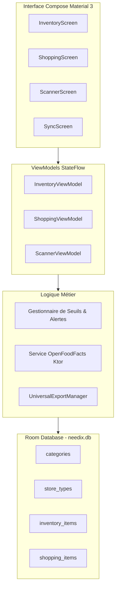

# Spécifications Fonctionnelles & Techniques Détaillées — Needix

> **Application** : Needix — Gestionnaire d'Inventaire Universel & Courses Intelligentes  
> **Package ID actuel** : `com.example` ➔ **Cible normalisée** : `fr.needix.app`  
> **Dépôt** : `Geoff1805/Needix` | **Emplacement local** : `G:\Mon Drive\05_Dev\Needix`  
> **Statut** : Spécification détaillée avec plan d'allègement de stack

---

## 1. Diagnostic de Stack : Allègement & Éradication des Doublons

### 1.1. Bilan Critique du Stack Actuel (Sur-complexité détectée)
Needix présente actuellement une accumulation de briques redondantes qui alourdissent l'application ("trop de stack") :

| Brique Actuelle | Problème Détecté | Solution de Rationalisation (Socle Épuré) |
| :--- | :--- | :--- |
| **Double Moteur de Facturation** | Coexistence de `Google Play Billing` ET `RevenueCat` | **Supprimer RevenueCat** : Garder un gestionnaire de licence ultra-léger local ou Play Billing pur sans SDK intermédiaire. |
| **Réseau & Parsing** | `Retrofit` + `Moshi` + adaptateurs de réflexion générés | **Remplacer par Ktor Client + `kotlinx.serialization`** : Aligné sur Bullix, 0 réflexion, binaire plus léger de ~1,5 Mo. |
| **Package ID legacy** | Utilisation de `com.example` | **Renommer en `fr.needix.app`** pour éviter les collisions système Android et respecter les standards Google Play. |
| **Architecture Base Locale** | Room Android natif classique | **Migrer vers Room KMP (`androidx.room`)** pour partager la logique métier avec la cible Web/iOS. |

---

## 2. Architecture Logicielle & Modèle de Données



---

## 3. Spécifications Détaillées des Écrans (UI/UX)

### 3.1. Écran 1 : `InventoryScreen` (Tableau de Bord & Stock)
- **TopAppBar** :
  - Titre dynamique avec compteur total d'articles (ex: *Mon Garde-Manger (84 articles)*).
  - Barre de recherche avec autocomplétion instantanée (filtre au fil de la frappe).
  - Sélecteur de filtre rapide : `[Tous]`, `[Stock Faible ⚠️]`, `[Par Pièce / Placard]`, `[Par Magasin]`.
- **Bannière d'Alerte Réapprovisionnement** :
  - Si `articles_en_rupture > 0` : Affichage d'un bandeau jaune/orange :  
    `⚠️ X articles sont passés sous leur seuil d'alerte.`  
    Bouton d'action direct : *"Ajouter tout à la liste de courses (+)"*.
- **Liste des Articles (`LazyColumn`)** :
  - Carte article (`InventoryItemCard`) :
    - Emoji catégorie + Nom du produit en gras.
    - Badges contextuels : Lieu (ex: *Cuisine > Placard Épices*), Magasin favori (ex: *Supermarché*).
    - Contrôle de quantité rapide 1-Tap : Boutons `[-]` et `[+]` avec affichage de l'unité (ex: `3 bouteilles`, `500 g`, `2 packs`).
    - Jauge visuelle de niveau : Verte si stock confortable, orange si proche du seuil, rouge si `<= minThreshold`.
    - Clic long : Ouvre `ItemEditDialog` pour modifier tous les attributs ou supprimer.
- **Floating Action Button (FAB)** :
  - Bouton double : Clic court = Ajout manuel, Clic icône caméra = Viseur code-barres.

> ✍️ **[À COMPLÉTER PAR L'UTILISATEUR — Écran Inventaire]** :
> - *Comportement quand la quantité atteint 0 (supprimer, masquer, ou basculer en "Épuisé") :*
> - *Ajout de dates de péremption (DLC) avec notifications locales :*

---

### 3.2. Écran 2 : `ShoppingScreen` (Mode Courses Interactif)
- **Organisation par Rayon / Magasin** :
  - Les articles sont automatiquement regroupés par magasin préféré (`store_types`) :  
    *Supermarché*, *Pharmacie*, *Magasin Bio*, *Bricolage*, *Boulangerie*.
- **Composant Item Course (`ShoppingItemRow`)** :
  - Grande case à cocher tactile (cibles > 48x48px pour usage en marchant dans les rayons).
  - Quantité nécessaire à acheter.
  - Option "Mettre en attente" (`isOnHold`) pour les articles non urgents que l'on ne veut pas acheter aujourd'hui.
- **Bouton d'Action Flottant Bas de Page ("Terminer mes courses")** :
  - Boîte de dialogue de confirmation : *"Vous avez coché X articles. Réintégrer directement ces quantités dans le stock d'inventaire ?"*
  - Si oui ➔ Incrémentation automatique dans `inventory_items` et purge de `shopping_items`.

---

### 3.3. Écran 3 : `ScannerScreen` (Scan & Résolution OpenFoodFacts)
- **Viseur Caméra (CameraX + ML Kit)** :
  - Cadre de scan haute précision.
  - Détection instantanée du code-barres EAN13.
  - Résolution en cascade :
    1. Base locale `inventory_items` (si le produit est déjà connu ➔ incrémentation directe de +1).
    2. Cache hors-ligne des produits fréquents.
    3. Requête API OpenFoodFacts (v2 JSON) pour récupérer automatiquement : Nom de marque, désignation, photo miniature, quantité standard.
- Si le produit est introuvable sur OpenFoodFacts : Ouverture immédiate de la fiche de saisie pré-remplie avec le code-barres.

---

### 3.4. Écran 4 : `SyncScreen` (Sauvegarde, Restauration & Export CSV/Sheets)
- **Export Universel** :
  - Bouton "Exporter l'inventaire en CSV / Excel".
  - Bouton "Sauvegarde complète JSON" (permettant une restauration intégrale sur un autre smartphone).
- **Import & Récupération** :
  - Import de fichier CSV avec mapping intelligent des colonnes (Nom, Catégorie, Quantité, Seuil).

---

## 4. Modèle de Données Exhaustif (Room SQLite — `AppDatabase`)

### 4.1. Table `categories`
```sql
CREATE TABLE IF NOT EXISTS categories (
    id TEXT PRIMARY KEY NOT NULL,             -- Ex: "food", "hygiene", "diy", "pets"
    name TEXT NOT NULL,                      -- "Alimentation", "Entretien", "Bricolage"
    iconEmoji TEXT NOT NULL,                 -- "🥫", "🧼", "🔧"
    colorHex INTEGER NOT NULL,               -- Couleur ARGB pour les badges
    orderIndex INTEGER NOT NULL DEFAULT 0
);
```

### 4.2. Table `store_types`
```sql
CREATE TABLE IF NOT EXISTS store_types (
    id TEXT PRIMARY KEY NOT NULL,             -- Ex: "supermarket", "pharmacy", "bakery"
    name TEXT NOT NULL,                      -- "Supermarché", "Pharmacie", "Boulangerie"
    iconEmoji TEXT NOT NULL,                 -- "🛒", "💊", "🥖"
    colorHex INTEGER NOT NULL,
    orderIndex INTEGER NOT NULL DEFAULT 0
);
```

### 4.3. Table `inventory_items`
```sql
CREATE TABLE IF NOT EXISTS inventory_items (
    id INTEGER PRIMARY KEY AUTOINCREMENT NOT NULL,
    name TEXT NOT NULL,                      -- Nom du produit (ex: "Lait demi-écrémé")
    categoryId TEXT NOT NULL,                -- Clé étrangère vers categories(id)
    quantity INTEGER NOT NULL DEFAULT 1,     -- Quantité actuelle en stock
    minThreshold INTEGER NOT NULL DEFAULT 1, -- Seuil d'alerte minimal
    unit TEXT NOT NULL DEFAULT 'pièce',      -- 'pièce', 'kg', 'L', 'paquet', 'boîte'
    preferredStoreId TEXT NOT NULL DEFAULT 'supermarket',
    barcode TEXT,                            -- Code-barres EAN13 optionnel
    location TEXT NOT NULL DEFAULT 'Maison', -- Placard, Cave, Congélateur, Garage
    notes TEXT NOT NULL DEFAULT '',
    updatedAt INTEGER NOT NULL,              -- Epoch timestamp de dernière modification
    FOREIGN KEY (categoryId) REFERENCES categories(id) ON DELETE RESTRICT,
    FOREIGN KEY (preferredStoreId) REFERENCES store_types(id) ON DELETE RESTRICT
);
CREATE INDEX IF NOT EXISTS idx_inv_barcode ON inventory_items(barcode);
CREATE INDEX IF NOT EXISTS idx_inv_category ON inventory_items(categoryId);
```

### 4.4. Table `shopping_items`
```sql
CREATE TABLE IF NOT EXISTS shopping_items (
    id INTEGER PRIMARY KEY AUTOINCREMENT NOT NULL,
    inventoryItemId INTEGER,                 -- Null si article ponctuel hors stock
    name TEXT NOT NULL,
    categoryId TEXT NOT NULL,
    storeId TEXT NOT NULL DEFAULT 'supermarket',
    quantityNeeded INTEGER NOT NULL DEFAULT 1,
    unit TEXT NOT NULL DEFAULT 'pièce',
    isPurchased INTEGER NOT NULL DEFAULT 0,  -- 0 = à acheter, 1 = coché dans le chariot
    isOnHold INTEGER NOT NULL DEFAULT 0,     -- 1 = reporté aux prochaines courses
    barcode TEXT,
    addedAt INTEGER NOT NULL,
    FOREIGN KEY (inventoryItemId) REFERENCES inventory_items(id) ON DELETE SET NULL
);
CREATE INDEX IF NOT EXISTS idx_shop_store ON shopping_items(storeId);
CREATE INDEX IF NOT EXISTS idx_shop_purchased ON shopping_items(isPurchased);
```

---

## 5. Algorithmes Métiers & Règles de Gestion

### 5.1. Règle de Génération Automatique des Courses
- À chaque mise à jour de stock dans `inventory_items` :
  - Si `quantity <= minThreshold` :
    - Vérifier si un item existe déjà dans `shopping_items` avec `inventoryItemId == item.id` et `isPurchased == 0`.
    - Si non présent : Insérer automatiquement dans `shopping_items` avec `quantityNeeded = (minThreshold * 2) - quantity` (réapprovisionnement suffisant pour repasser au-dessus du seuil).

### 5.2. Règle de Réintégration Post-Courses
- Quand l'utilisateur clique sur "Terminer mes courses" :
  ```kotlin
  @Transaction
  suspend fun completeShoppingSession() {
      val purchased = shoppingDao.getPurchasedItems()
      for (item in purchased) {
          if (item.inventoryItemId != null) {
              inventoryDao.incrementQuantity(item.inventoryItemId, item.quantityNeeded)
          }
      }
      shoppingDao.deletePurchasedItems()
  }
  ```

---

## 6. Cas Limites & Gestion des Erreurs
1. **Article sans code-barres (fruits, légumes, vrac)** : Saisie manuelle facilitée avec mémorisation des suggestions fréquentes.
2. **Scan hors-ligne** : Si pas de connexion, consultation du dictionnaire local puis ouverture d'un formulaire vierge avec le code pré-rempli sans bloquer l'UI.
3. **Import CSV corrompu** : Validation des types ligne par ligne avec rapport des erreurs sans faire crasher l'import global.
